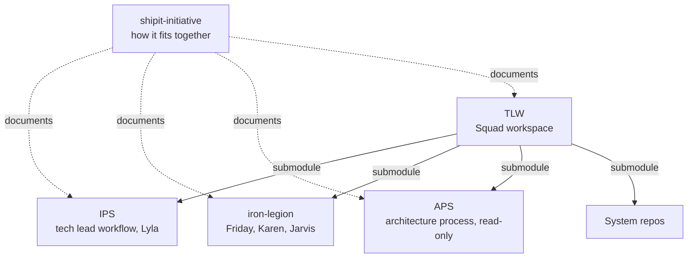
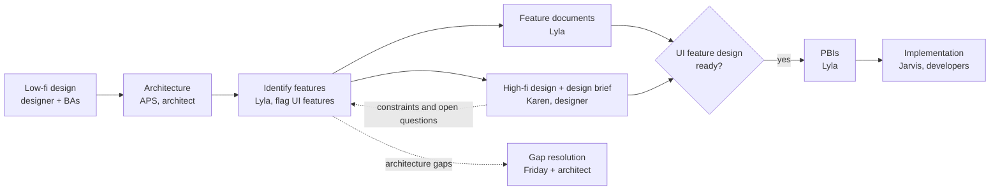

# Repository and Agent Design

> Status: Draft
> Last updated: 2026-11-20
> Owner: Tech Lead

## Purpose

This document records the design of the repositories and AI agents that support our software delivery process, from the moment architecture documentation is handed to the Tech Lead through implementation. It captures the decisions made so far, the reasoning, and what is still open.

This repository (`shipit-initiative`) is the parent. It describes how the other repositories fit together. It holds no agents, templates, or code, and has no git submodules. Each repository named below is authoritative for its own content. This document links to them and never restates their rules.

## Decision Status

Each decision is marked with one of:

- **Decided**: agreed in discussion.
- **Proposed**: recommended and not contradicted, but not yet explicitly confirmed. Confirm or change.

## Guiding Principles

1. **Link, don't restate.** A rule has one owning repository. Other repositories link to it, pinned by tag, so a link is a deliberate choice and staleness is visible.
2. **One owner per format.** The repository that produces an artifact defines its format. Consumers read that definition and never keep their own copy.
3. **Agents describe roles, not environments.** An agent defines behavior and its own interface. It does not hardcode paths into sibling repositories.
4. **Discover at runtime.** Agents find the documentation layout by reading each repository's `docs/README.md`, not from a hardcoded table.
5. **Ownership by folder.** When several people or agents write into the same `docs/` tree, each folder has exactly one owner.
6. **Agents propose, people decide.** This holds for the architect agent in particular, consistent with APS.

## Repositories

| Repository | Role | Contains |
|---|---|---|
| `shipit-initiative` | Parent. Documents how everything fits together. | Delivery process, component map, handoff contracts, docs layout contract, this design |
| `ARC-APS_ArchitectureProcessSystem` (APS) | The architect's process for producing architecture docs. Owned by the architect. Read-only to us. | Process guide, templates, instructions, examples |
| `IPS_ImplementationPlanningSystem` (IPS) | The Tech Lead workflow only | Lyla, process guide, skills, templates, examples for features, feature documents, PBIs, and the architecture gap-resolution workflow |
| `iron-legion` | Agent library. Role-based agents usable on their own. | Friday (architect), Karen (UI/UX designer), Jarvis (developer) |
| `TLW_TechLeadWorkspace` (TLW) | The Tech Lead's working environment: a Squad team. Also the template other teams copy. | Squad charters, routing, workspace settings, git submodules |

Dependencies point one way. `shipit-initiative`, IPS, iron-legion, and APS do not depend on each other or on TLW. Only TLW wires them together.

## Decisions

### D1. `shipit-initiative` is a documentation-only parent (Decided)

It outlines the software delivery process from architecture handoff through development, with links and references to each phase's owning repository. It uses no git submodules.

It contains:

- The delivery process: phases, entry and exit conditions, roles, and which repository or agent handles each phase.
- A component map: each repository, its role, owner, and agents, whether it is used standalone or through the workspace, and how to install it.
- Handoff contracts: the artifact that crosses each boundary, who produces and consumes it, where it lives, and which repository owns its format.
- The docs layout contract (see D7).
- Getting started by role: developer, designer, Tech Lead, and a team adopting this process.
- A record of structural decisions like those in this document.

### D2. IPS documents only the Tech Lead workflow (Decided)

IPS holds Lyla, the process guide, skills, templates, and examples for identifying features, writing feature documents, and generating PBIs, including publishing to Azure DevOps. It also holds the architecture gap-resolution workflow: finding a gap, proposing options, getting the architect's approval, then updating docs.

IPS does not describe how Jarvis, Karen, or the architect work. Those belong to iron-legion and APS. How the pieces fit is described in `shipit-initiative`.

### D3. `iron-legion` is the agent library (Decided)

Contains Friday, Karen, and Jarvis. Each is usable on its own, without the Squad or IPS. Developers use Jarvis directly, and the UI designer uses Karen directly.

Agents are kept in one repository with one folder per agent, each with its own prompts, skills, and instructions.

### D4. Friday is a thin architect agent in `iron-legion` (Decided)

Friday is refactored from a documentation updater into a senior architect agent, well versed in the Microsoft Azure Well-Architected Framework. She carries behavior only:

- Well-Architected Framework fluency, applied through a review skill structured on the framework's pillars.
- The stance that she proposes and the architect decides.
- Minimal, scoped edits that preserve existing terminology.
- Justifying options on their merits, not by citing existing architecture docs.

She does not carry document rules. In the workspace, document rules, templates, and examples come from APS through a read-only submodule.

Consequences:

- Friday looks up the rules for a document type in APS at runtime: read `docs-templates/INDEX.md` and `docs/document-catalog.md`, identify the type, then read that package's README, instructions, template, and example before editing. APS `applyTo` patterns are not relied upon, because they target a consuming repository's paths.
- If APS is not present, Friday says so and does not invent rules.
- If a document does not match the current APS template, Friday reports it and does not rewrite it.
- The ADU repository's copies of APS templates and instructions are not carried forward. Those copies have already drifted from APS. (Proposed: retire ADU once Friday has moved.)

### D5. TLW is the Squad workspace and a template for other teams (Decided)

TLW holds the Squad team and has git submodules for:

- IPS (Lyla and the process)
- APS (read-only, for Friday's document rules)
- `iron-legion` (Friday, and Karen and Jarvis as needed)
- The system repositories

Squad charters are thin. A charter states the member's role and when to call it, then points to the canonical agent file, and the wiring to APS and IPS. It does not restate agent rules. (Proposed: verify how Squad resolves file references before committing to this.)

TLW is published as a GitHub template repository so other teams can copy it, edit their team-specific content, and add their own system submodules.

Squad roster and routing:

| Member | Agent source | Called for |
|---|---|---|
| Lyla | IPS | Identify features, feature documents, PBIs, publish to Azure DevOps |
| Friday | iron-legion | Architecture gap resolution and architecture doc updates |
| Karen | iron-legion | High-fidelity design, when the Tech Lead needs it |
| Jarvis | iron-legion | Implementation and doc sync, when used from the workspace |

### D6. Standalone use of agents (Decided in intent, mechanism Proposed)

Developers and the designer use agents from `iron-legion` without the Squad or IPS. The intent is that no agent file is copied between repositories.

Proposed mechanism: the user clones `iron-legion` once and adds its folders to the user-level Copilot agent, instruction, and skill location settings in VS Code. Updates are a `git pull`. An install script can clone and write the settings. Exact setting names must be verified against the current VS Code version. Alternatives, in case this proves insufficient: VS Code agent plugins, organization-level agents, or CI-generated release bundles.

Avoid git submodules for standalone users, and avoid symlinks, which are unreliable on Windows.

### D7. Docs layout contract (Proposed)

The `docs/` directory in a system repository is shared. APS defines the architecture layout. IPS adds `refinements/`. The designer adds design folders. Every agent needs to know the layout, but no agent should carry the full table.

Three layers:

| Layer | Owner | Content |
|---|---|---|
| Top-level namespace ownership | `shipit-initiative` | A short table naming who owns each top-level `docs/` folder, linking to the canonical doc |
| Folder internals | The owning repository | APS `document-catalog.md` for architecture docs. IPS for `refinements/{cycle}/` and its subfolders. |
| What exists in a given repository | That repository's `docs/README.md` | APS already requires this inventory |

Rules:

- Agents read `docs/README.md` first and treat it as the map for that repository. Repositories differ in practice, so hardcoded paths are unreliable.
- Each agent states only its own interface: the folders it reads and writes, and the rule "paths come from `docs/README.md`, ask if missing".
- Guests live under the owner's namespace.

Initial namespace ownership:

| Path under `docs/` | Owner |
|---|---|
| Architecture, registers, contracts, process-flows, data-models, infrastructure, and related folders | APS (the architect) |
| `refinements/{cycle}/identified-features.md`, `features/`, `pbis/`, `user-stories/`, `dependency-graph.md` | IPS (Tech Lead, Lyla) |
| `refinements/{cycle}/ui-designs/` | UI designer (Karen) |
| `design/low-fidelity/` (proposed, see D9) | UI designer |

Dependency on the architect: APS's docs-readme template needs an extension point so that folders not owned by APS can be listed as downstream- or input-owned. Without it the inventory would contradict the actual folders. This is a pending request to the architect.

### D8. Delivery flow with a design fork and join (Decided)

| Phase | Actors | Output | Tooling |
|---|---|---|---|
| Discovery design (low-fi) | UI designer and BAs | Low-fidelity design, an input to architecture | Designer's choice |
| Architecture | Architect | Architecture docs, citing the low-fi design as an input | APS |
| Gap resolution | Tech Lead and architect | Approved architecture doc updates | Friday, IPS workflow |
| Feature identification | Tech Lead | Identified features, UI features flagged | Lyla |
| High-fi design | UI designer | Mockups and a design brief per UI feature | Karen |
| Feature docs and PBIs | Tech Lead | Feature documents and PBIs, requirements derived from the design brief | Lyla |
| Implementation | Developers | Code built from feature document, PBI, and design | Jarvis |

Decisions within the flow:

- **Parallel work by two people.** After features are identified, Lyla (run by the Tech Lead) and Karen (run by the UI designer) work in parallel.
- **One cycle branch.** Both commit to the same cycle branch, in different directories, so there is no overlap to merge.
- **Join at PBI generation.** Lyla may draft UI feature documents in parallel with the Design section pending, but does not generate PBIs for a UI feature until the design brief marks it ready.
- **No designer review of PBIs.** The designer produces the design brief. Lyla uses it to generate requirements for PBIs.
- **Design brief.** The designer produces a design brief that Lyla uses as input to PBI requirements. Lyla uses only its requirements-level content and does not copy implementation notes into PBIs.
- **Assumptions are not promoted.** Assumptions and open questions in the brief stay open questions in the feature document and PBI until confirmed.
- **Feedback loops.** Designer to Tech Lead through open questions in the brief. Tech Lead to designer through constraints noted in `identified-features.md`. Architecture gaps from either side go to gap resolution.

### D9. Coordination artifacts (Proposed, details open)

- **UI feature request.** `identified-features.md`, owned by Lyla, is the designer's work request. For each UI feature it lists the screens needed, the cycle, links to the relevant architecture docs, and design-affecting constraints such as latency, pagination, and data limits. The designer reads it and does not edit it.
- **Design brief.** One file per cycle at `refinements/{cycle}/ui-designs/`, replacing Karen's current `design.md`, with a section per design. Each section has two parts: Requirements (read by Lyla) and Build notes (for developers). Each section carries a status, `Draft` or `Ready for PBIs`, owned by the designer. The join rule checks this status.
- **Low-fidelity design.** Proposed location: `docs/design/low-fidelity/{feature-key}/`. It exists before any refinement cycle, so it is not under `refinements/`. It is committed in the system repository, so the architect sees it through his existing submodule workflow. A new top-level `docs/design/` needs the architect's agreement (see D7). Final location is still open.

### D10. Where team-specific knowledge lives (Proposed)

Agents must be reusable by other teams, so team-specific content is kept separate from agent logic. Examples of team-specific content: tech stack, coding standards, logging and infrastructure conventions, the Azure DevOps organization and area path, and the Telerik design assets.

For now each repository keeps these in a clearly separated `profile/` folder. A team copying the process replaces that folder. If planning-level and coding-level knowledge about the stack start to drift apart, promote it to a single shared team-profile repository. This is tentative.

### D11. Contract between IPS and Jarvis (Proposed)

IPS owns the feature document and PBI format. Jarvis needs to read it. Either Jarvis links to the IPS definition by pinned tag, or CI publishes a generated snapshot into the `iron-legion` release bundle. The snapshot is never edited by hand.

### D12. Versioning and drift (Proposed)

- Submodules in TLW are pinned to a tag or commit. Upgrades are deliberate.
- Links between repositories use tags.
- A lightweight drift check, modeled on APS's governance checks, verifies that the component map and docs layout in `shipit-initiative` match the repositories, and that every folder under `refinements/` is listed in the system repository's `docs/README.md`.

## Current State to Target Mapping

| Current | Target |
|---|---|
| `TLA` `agents/Lyla.agent.md` | IPS |
| `TLA` skills for features, feature docs, PBIs, import, publish, parse | IPS |
| `TLA` `skills/azure-devops-cli` | IPS (promote to `iron-legion` if a second agent needs it) |
| `TLA` instructions and templates for feature planning, PBI generation, architecture reading, ADO import and publish | IPS |
| `TLA` `tech-stack`, `blazor-conventions`, `config.json` | `profile/` folder in IPS |
| `TLA` `improvements.md` | TLW. Generalizable lessons are promoted to IPS. |
| `TLA` `skills/suggest-agent-improvements` | IPS, with the log path made configurable |
| `TLA` `chatmodes/lyla.chatmode.md` | Delete. A stub superseded by `Lyla.agent.md`. |
| `TLA` `copilot-instructions.md` | TLW, rewritten for Squad routing |
| `SDA` `agents/Jarvis.agent.md`, `prompts/add-logging` | `iron-legion` |
| `SDA` coding, logging, and infrastructure instructions | `profile/` folder in `iron-legion` |
| `SDA` `feature-documents.instructions.md` | IPS, as a consumer guide (see D11) |
| `SDA` `documentation-structure.instructions.md` | Split. The `refinements/` part goes to IPS. The layout table is replaced by runtime discovery (D7). |
| `UDA` `agents/Karen.agent.md`, `prompts/generate-mockup` | `iron-legion`. Needs updating (see Next Steps). |
| `UDA` mockup layout and Telerik assets | `profile/` folder in `iron-legion` |
| `ADU` `agents/Friday.agent.md` | `iron-legion`, refactored per D4 |
| `ADU` `instructions/*`, `templates/*` | Not carried forward. Read from APS (D4). |
| `ADU` `prompts/review-full-documentation.md` | Review during Friday's refactor |

## Cautions to Design Around

- **Multi-root `applyTo` leakage.** In a multi-root workspace, `applyTo` instructions from every root load for all roots (for example, Jarvis's `**/*.cs` coding standards already apply everywhere). Scope instructions by path.
- **Karen's Telerik assets are copies of the MFG-HUB app's.** Decide whether the app repository or the profile folder is the single source of truth.
- **Lyla's principle "don't block on missing information"** needs an explicit exception: she must stop when a UI feature has no ready design.
- **Lyla hardcodes the improvements log path** `TLA_TechLeadAgent/.github/improvements.md`. Make it configurable.

## Open Questions

1. Final location for low-fidelity design (`docs/design/low-fidelity/` proposed).
2. Extension point in APS's docs-readme template for non-APS folders. Pending request to the architect.
3. Confirm retiring ADU after Friday moves.
4. Separate team-profile repository versus `profile/` folders (D10).
5. Standalone install mechanism (D6): settings pointing at a clone, VS Code agent plugins, organization-level agents, or release bundles.
6. How Squad resolves file references in charters, and how it discovers agent files in submodules.
7. How Friday locates APS: search for `docs-templates/INDEX.md`, or a configuration file.
8. Where the development and doc-sync process is documented. Likely `shipit-initiative`, since no process repository exists for development.
9. Whether the designer's Karen workflow also covers low-fidelity design, or only high-fidelity.
10. Whether Jarvis belongs in the Squad or is used only in system repositories.

## Next Steps

1. Update Karen: rename `design.md` to `design-brief.md` with the Requirements and Build notes structure and a status field. References to the old name are in her agent file and the `generate-mockup` prompt.
2. Refactor Friday per D4, including the Well-Architected Framework review skill and the APS lookup step.
3. Add the design-ready gate and the design-brief handling to Lyla.
4. Send the architect the APS docs-readme extension request.
5. Create the `iron-legion` repository and migrate Friday, Karen, and Jarvis.
6. Populate IPS with Lyla, skills, templates, and the gap-resolution workflow.
7. Build the TLW Squad template with submodules and wiring.
8. Fill in the rest of this repository: delivery process, component map, handoff contracts, and docs layout contract.
